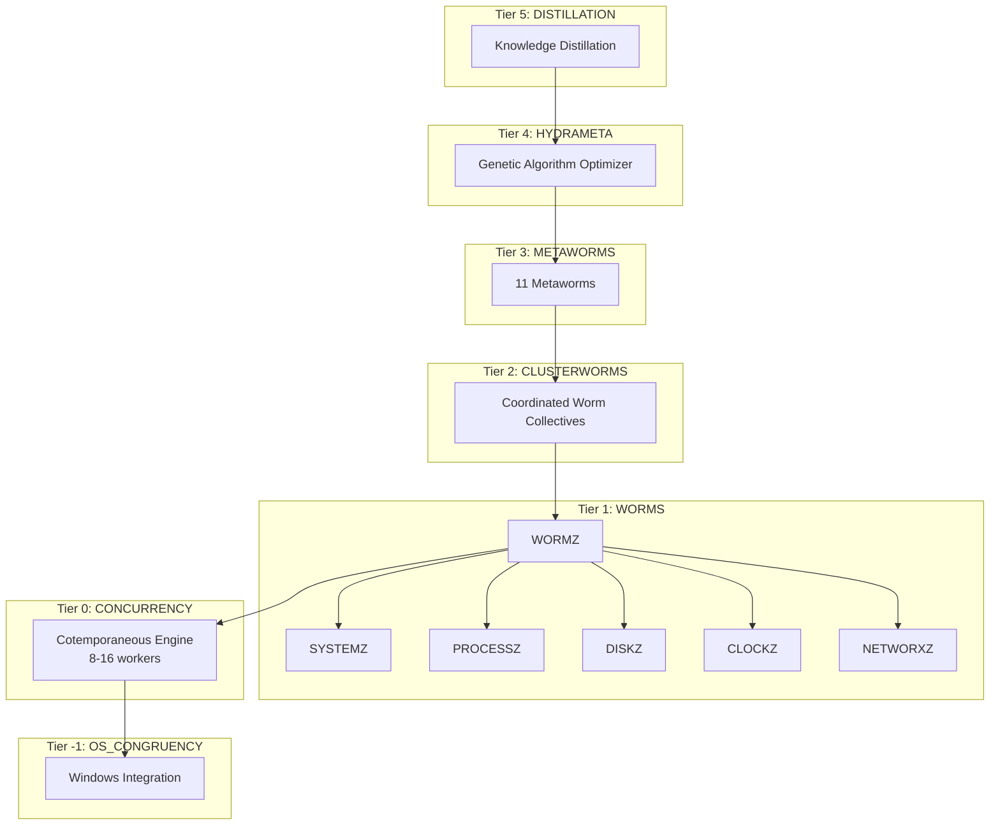
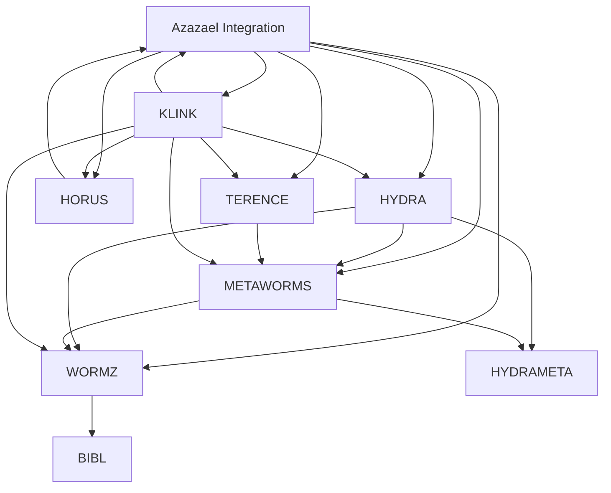
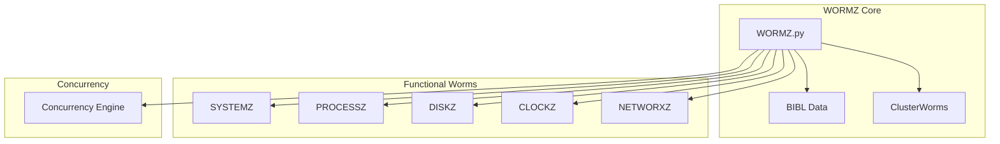
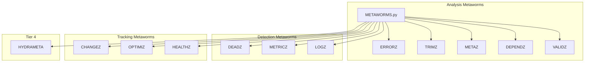
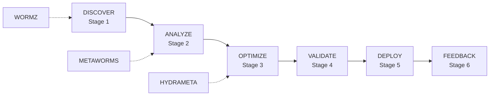

# Azazael Ecosystem Dependency Graph

**Version:** 1.0.0  
**Date:** 2026-02-11

---

## System Architecture



---

## Component Dependencies



---

## WORMZ Layer



---

## METAWORMS Layer



---

## HYDRA Pipeline



---

## Dependency Matrix

| Component | Depends On | Dependents |
|-----------|------------|-----------|
| Azazael | None | All |
| HYDRA | WORMZ, METAWORMS | KLINK |
| WORMZ | BIBL | HYDRA, METAWORMS |
| METAWORMS | WORMZ | HYDRA, TERENCE |
| HORUS | Azazael | KLINK |
| TERENCE | METAWORMS | KLINK |
| KLINK | All | None |
| HYDRAMETA | WORMZ | HYDRA |

---

## File Dependencies

```python
# Key import relationships

# Azazael Integration
from Azazael.HYDRA import HYDRACluster
from Azazael.WORMZ import WORMZ
from Azazael.METAWORMS import METAWORMS, HYDRAMETA
from Azazael.HORUS import HORUS
from Azazael.TERENCE import TERENCE

# HYDRA
from HYDRA.HYDRA import HYDRACluster
from METAWORMS.HYDRAMETA import HYDRAMETA
from WORMZ.WORMZ import WORMZ

# WORMZ
from WORMZ.SYSTEMZ import SYSTEMZ
from WORMZ.PROCESSZ import PROCESSZ
from WORMZ.DISKZ import DISKZ
from WORMZ.CLOCKZ import CLOCKZ
from WORMZ.NETWORXZ import NETWORXZ

# METAWORMS
from METAWORMS.METAWORMS import METAWORMS
from METAWORMS.HYDRAMETA import HYDRAMETA
from WORMZ.WORMZ import WORMZ
```

---

*Generated: 2026-02-11*
