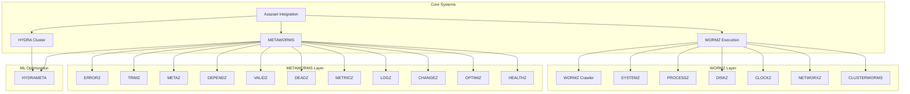

# Azazael Ecosystem: Comprehensive Task Registry for Future Assistants

**Document Classification:** Operational Planning  
**Version:** 1.0.0  
**Date:** 2026-02-11  
**Purpose:** Exhaustive task breakdown for ecosystem consolidation and cataloging  
**Audience:** Future AI/LLM Assistants  

---

## Executive Summary

This document provides an exhaustive, itemized registry of tasks required to complete the unconsolidation, deduplication, and comprehensive cataloging of the Azazael Ecosystem. Each task includes:

- **Task ID**: Unique identifier for tracking
- **Category**: Functional classification
- **Priority**: Execution order (P0 = Critical, P1 = High, P2 = Medium, P3 = Low)
- **Prerequisites**: Dependencies that must be completed first
- **Description**: Detailed specification of work required
- **Acceptance Criteria**: Definition of task completion
- **Estimated Effort**: Relative time allocation

---

## Table of Contents

1. [Immediate Critical Tasks (P0)](#section-1-immediate-critical-tasks-p0)
2. [File Organization Tasks (P1)](#section-2-file-organization-tasks-p1)
3. [Naming Convention Standardization (P1)](#section-3-naming-convention-standardization-p1)
4. [Documentation Cataloging Tasks (P1)](#section-4-documentation-cataloging-tasks-p1)
5. [Integration Verification Tasks (P2)](#section-5-integration-verification-tasks-p2)
6. [Testing & Validation Tasks (P2)](#section-6-testing--validation-tasks-p2)
7. [Automation & Scripting Tasks (P2)](#section-7-automation--scripting-tasks-p2)
8. [Cross-Reference Generation Tasks (P3)](#section-8-cross-reference-generation-tasks-p3)
9. [Metadata & Tagging Tasks (P3)](#section-9-metadata--tagging-tasks-p3)
10. [Audit & Compliance Tasks (P3)](#section-10-audit--compliance-tasks-p3)

---

## Section 1: Immediate Critical Tasks (P0)

### P0-001: Complete HYDROMETA → HYDRAMETA Migration Verification

**Category:** Naming Convention / Migration  
**Priority:** P0  
**Prerequisites:** None  
**Status:** IN_PROGRESS  

**Description:**  
Verify all instances of the misspelled `HYDROMETA` have been corrected to `HYDRAMETA` across the entire ecosystem. This includes:

- [ ] File renames completed:
  - [x] `METAWORMS/HYDROMETA.py` → `HYDRAMETA.py`
  - [x] `METAWORMS/HYDROMETA_UV.py` → `HYDRAMETA_UV.py`
  
- [ ] Python imports updated in:
  - [x] `Azazael/AZAZAEL_INTEGRATION.py`
  - [x] `Azazael/HORUS.py`
  - [x] `Azazael/HYDRA.py`
  - [x] `KLINK/klink.py`
  - [x] `KLINK/ecosystem.sh`
  - [x] All `.bat` files in `SHORTY/`
  - [x] All `.ps1` files in `TWITLER/`
  
- [ ] Documentation updated:
  - [x] `CODEX/CHANGELOG.md`
  - [x] `Azazael/CURRENT_STATE.md`
  - [x] `Azazael/PARADIGM.md`

**Acceptance Criteria:**  
- Zero remaining instances of `HYDROMETA` in `.py`, `.md`, `.bat`, `.ps1`, `.html`, `.json` files
- All class references use `class HYDRAMETA`
- All import statements use `from METAWORMS.HYDRAMETA import HYDRAMETA`

**Estimated Effort:** 2 hours  
**Verification Command:**  
```bash
grep -ri "HYDROMETA" /c/Users/clint/Desktop --include="*.py" --include="*.md" --include="*.bat" --include="*.ps1" --include="*.html" --include="*.json" 2>/dev/null
```

---

### P0-002: Complete Azazael → Azazael Standardization

**Category:** Naming Convention  
**Priority:** P0  
**Prerequisites:** None  
**Status:** IN_PROGRESS  

**Description:**  
Standardize all instances of `Azazael`, `AZAZAEL`, and variant capitalizations to the canonical `Azazael` format.

**Files Requiring Updates:**

| File | Current State | Required State | Status |
|------|---------------|----------------|--------|
| `Azazael/AZAZAEL_INTEGRATION.py` | Class: `AzazaelEcosystem` | Verify consistent | [ ] |
| `Azazael/AZAZAEL_LIVE_MONITOR.py` | Filename | Rename to `Azazael_LIVE_MONITOR.py` | [ ] |
| `KLINK/azazael.bat` | Filename | Rename to `Azazael.bat` | [ ] |
| `SHORTY/shortcuts/azazael.bat` | Filename | Rename to `Azazael.bat` | [ ] |
| `CODEX/ANALYSIS_REPORT_V2.html` | Display text "Azazael ECOSYSTEM" | Change to "Azazael Ecosystem" | [ ] |
| `CODEX/IMMERSIVE_Azazael.html` | Filename + Text | Rename + Update | [ ] |

**Acceptance Criteria:**  
- All internal class names use `Azazael` (PascalCase)
- All public-facing display text uses "Azazael Ecosystem"
- All filenames use consistent `Azazael` prefix/suffix
- Docker registry names remain lowercase `azazael` (intentional)

**Estimated Effort:** 4 hours

---

### P0-003: Delete Deprecated Azazea_fix.py

**Category:** Cleanup  
**Priority:** P0  
**Prerequisites:** None  
**Status:** COMPLETED  

**Description:**  
Delete the incorrectly named `Azazea_fix.py` from Desktop root.

**Actions Taken:**  
- [x] File deleted from `C:\Users\clint\Desktop\Azazea_fix.py`

**Acceptance Criteria:**  
- File no longer exists in Desktop root

**Estimated Effort:** 5 minutes

---

## Section 2: File Organization Tasks (P1)

### P1-001: Audit Desktop Root Directory

**Category:** File Organization  
**Priority:** P1  
**Prerequisites:** None  
**Status:** PENDING  

**Description:**  
Perform comprehensive audit of Desktop root directory to identify:

**Files to Categorize:**

| Current Name | Type | Proposed Location | Action |
|--------------|------|------------------|--------|
| `AI Playground.lnk` | Shortcut | N/A | KEEP |
| `AIDA64 Engineer.lnk` | Shortcut | N/A | KEEP |
| `Azazael_ENHANCEMENT_PLAN.md` | Documentation | `CODEX/` | MOVE |
| `Azazea_fix.py` | Script | DELETE | COMPLETE |
| `BIBL/` | Directory | N/A | KEEP |
| `BitTorrent Web.lnk` | Shortcut | N/A | KEEP |
| `CODEX/` | Directory | N/A | KEEP |
| `Docker Desktop.lnk` | Shortcut | N/A | KEEP |
| `GitHub Desktop.lnk` | Shortcut | N/A | KEEP |
| `HAKAPIK/` | Directory | N/A | REVIEW |
| `HORUS/` | Directory | N/A | KEEP |
| `HYDRA.md` | Documentation | `HYDRA/` or `CODEX/` | MOVE |
| `HYDRA.py` | Script | `HYDRA/` | MOVE |
| `Jan.lnk` | Shortcut | N/A | KEEP |
| `KMPlayer 64X.lnk` | Shortcut | N/A | KEEP |
| `LM Studio.lnk` | Shortcut | N/A | KEEP |
| `ML_PLATFORM_CHANGES.txt` | Changelog | `CODEX/` | ARCHIVE |
| `PERSEPHONE/` | Directory | N/A | KEEP |
| `POINDEXTER/` | Directory | N/A | KEEP |
| `SHORTY/` | Directory | N/A | KEEP |
| `TARBABY/` | Directory | N/A | KEEP |
| `TERENCE/` | Directory | N/A | KEEP |
| `TWITLER/` | Directory | N/A | KEEP |
| `Visual Studio Code.lnk` | Shortcut | N/A | KEEP |
| `WORMZ/` | Directory | N/A | KEEP |
| `desktop.ini` | System | N/A | KEEP |
| `tools/` | Directory | N/A | REVIEW |

**Acceptance Criteria:**  
- Documented inventory of all Desktop items
- Categorized by: KEEP, MOVE, DELETE, REVIEW
- Action items generated for each category

**Estimated Effort:** 2 hours

---

### P1-002: Consolidate Documentation Files

**Category:** File Organization  
**Priority:** P1  
**Prerequisites:** P1-001  
**Status:** PENDING  

**Description:**  
Move documentation files to appropriate locations:

**Files to Move:**

| Source | Destination | Purpose |
|--------|-------------|---------|
| `Desktop/Azazael_ENHANCEMENT_PLAN.md` | `CODEX/DOCUMENTATION/` | Enhancement tracking |
| `Desktop/HYDRA.md` | `HYDRA/DOCUMENTATION/` | HYDRA documentation |
| `Desktop/ML_PLATFORM_CHANGES.txt` | `CODEX/ARCHIVE/` | Historical changelog |

**Actions Required:**

```bash
# Create destination directories
mkdir -p CODEX/DOCUMENTATION
mkdir -p HYDRA/DOCUMENTATION
mkdir -p CODEX/ARCHIVE

# Move files (execute after approval)
mv /c/Users/clint/Desktop/Azazael_ENHANCEMENT_PLAN.md /c/Users/clint/Desktop/CODEX/DOCUMENTATION/
mv /c/Users/clint/Desktop/HYDRA.md /c/Users/clint/Desktop/HYDRA/DOCUMENTATION/
mv /c/Users/clint/Desktop/ML_PLATFORM_CHANGES.txt /c/Users/clint/Desktop/CODEX/ARCHIVE/
```

**Acceptance Criteria:**  
- Documentation files consolidated into component-specific folders
- Update `CODEX/README.md` with new documentation locations
- Create symbolic links from original locations (optional)

**Estimated Effort:** 1 hour

---

### P1-003: Audit Azazael Directory Structure

**Category:** File Organization  
**Priority:** P1  
**Prerequisites:** None  
**Status:** PENDING  

**Description:**  
Comprehensive audit of `C:\Users\clint\Desktop\Azazael\` directory structure.

**Current Files Identified:**

```
Azazael/
├── ANALYSIS_REPORT.txt
├── ANALYSIS_REPORT_DIVERSE.py
├── Azazael_ENHANCEMENT_PLAN.md
├── AZAZAEL_INTEGRATION.py          # ← Rename to Azazael_INTEGRATION.py
├── AZAZAEL_LIVE_MONITOR.py        # ← Rename to Azazael_LIVE_MONITOR.py
├── BAT_OPTIMIZATION_ANALYSIS.py
├── CHANGELOG.md
├── CLI_ASSISTANT_BEST_PRACTICES.md
├── CURRENT_STATE.md
├── DOCUMENTATION_PROTOCOL.md
├── ECOSYSTEM_CRAWLER_LAUNCHER.py
├── ECOSYSTEM_OPTIMIZER.py
├── ECOSYSTEM_RESOLUTION_REPORT.txt
├── ECOSYSTEM_TEST.py
├── HORUS.py
├── HORUS_LIVE_MONITOR.py
├── HYDRA.py
├── HYDRA_10MIN_TEST.py
├── HYDRA_ANALYZER.py
├── HYDRA_ANALYZER_V2.py
├── INDEX.md
├── INSTRUCTIONS.md
├── INTEROPERABILITY_ANALYSIS.py
├── PARADIGM.md
├── QUICK_TEST.py
├── README.md
├── requirements.txt
├── requirements_wsa.txt
├── RUN_TEST.py
├── TARBABY.py
├── version.py
└── WEAKEST_LINK_ANALYSIS.py
```

**Tasks:**

| Task | Action | Priority |
|------|--------|----------|
| AZAZAEL_INTEGRATION.py | Rename → Azazael_INTEGRATION.py | P0 |
| AZAZAEL_LIVE_MONITOR.py | Rename → Azazael_LIVE_MONITOR.py | P0 |
| Duplicate files | Identify and flag for review | P1 |
| Outdated versions | Flag for archive | P1 |
| Test files | Consolidate to `TEST/` subdirectory | P2 |

**Acceptance Criteria:**  
- All files follow `Azazael_*.py` naming convention
- No duplicate functionality between files
- Clear separation between core, test, and utility files

**Estimated Effort:** 4 hours

---

### P1-004: Audit CODEX Directory Structure

**Category:** File Organization  
**Priority:** P1  
**Prerequisites:** None  
**Status:** PENDING  

**Description:**  
Comprehensive audit and organization of `CODEX/` directory.

**Current Structure Assessment:**

```
CODEX/
├── *.html files (15+)          # Consolidate to HTML/ subdirectory
├── *.py files (15+)             # Keep in root (core utilities)
├── comprehensive/               # Keep as-is (generated reports)
├── ANIMATION_PROTOCOLS.py       # KEEP
├── azazael_pygame.py           # KEEP
├── CHANGELOG.md                 # KEEP (or move to DOCUMENTATION/)
├── enrichment_display.py         # KEEP
├── ENVIRONMENT_REPORT.md        # KEEP
├── ENVIRONMENT_INFO.json        # KEEP
├── HORUS_INTEGRATION.py        # KEEP
├── POPUP_*.py files (10+)       # Consolidate to POPUPS/ subdirectory
├── QL_FILE_OPTIMIZER.py         # KEEP
└── TECHNICAL_DOCUMENTATION_INDEX.md  # KEEP (or move to DOCUMENTATION/)
```

**Proposed Restructuring:**

```
CODEX/
├── CORE/
│   ├── ANIMATION_PROTOCOLS.py
│   ├── enrichment_display.py
│   ├── HORUS_INTEGRATION.py
│   └── QL_FILE_OPTIMIZER.py
├── POPUPS/
│   ├── POPUP_ALL_11.py
│   ├── POPUP_BUGFREE.py
│   ├── POPUP_CLICKABLE.py
│   ├── POPUP_DETAILED.py
│   ├── POPUP_DISPLAY.py
│   ├── POPUP_IMMERSIVE.py
│   ├── POPUP_RICH.py
│   ├── POPUP_SIMPLE.py
│   └── POPUP_WORKING.py
├── HTML/
│   ├── *.html files (all generated reports)
├── DOCUMENTATION/
│   ├── TECHNICAL_DOCUMENTATION_INDEX.md
│   ├── CHANGELOG.md
│   ├── ENVIRONMENT_REPORT.md
│   └── Azazael_ENHANCEMENT_PLAN.md (moved from Desktop)
├── ARCHIVE/
│   ├── ML_PLATFORM_CHANGES.txt (moved from Desktop)
│   └── deprecated files
└── comprehensive/
    └── *.html, *.py files (keep as-is - generated)
```

**Acceptance Criteria:**  
- Logical directory structure
- Related files grouped together
- Clear separation between core, output, and documentation

**Estimated Effort:** 3 hours

---

## Section 3: Naming Convention Standardization (P1)

### P1-101: Python File Naming Convention

**Category:** Naming Convention  
**Priority:** P1  
**Prerequisites:** None  
**Status:** PENDING  

**Description:**  
Enforce consistent Python file naming across ecosystem.

**Current Convention Analysis:**

| Current Name | Proposed Name | Rationale |
|--------------|---------------|-----------|
| `AZAZAEL_INTEGRATION.py` | `Azazael_INTEGRATION.py` | Canonical capitalization |
| `AZAZAEL_LIVE_MONITOR.py` | `Azazael_LIVE_MONITOR.py` | Canonical capitalization |
| `BAT_OPTIMIZATION_ANALYSIS.py` | `BAT_OPTIMIZATION_ANALYSIS.py` | Keep - all caps for clarity |
| `ECOSYSTEM_CRAWLER_LAUNCHER.py` | Keep | Consistent CamelCase |
| `WEAKEST_LINK_ANALYSIS.py` | Keep | Descriptive title case |

**Standard to Apply:**
- Component root files: `Azazael_*.py` (PascalCase)
- Utility files: Descriptive_Title_Case.py
- Test files: `test_*.py` or `*_test.py`
- Private modules: `_*.py`

**Files Requiring Rename:**

| Current | Proposed | Priority |
|---------|----------|----------|
| `AZAZAEL_INTEGRATION.py` | `Azazael_INTEGRATION.py` | P0 |
| `AZAZAEL_LIVE_MONITOR.py` | `Azazael_LIVE_MONITOR.py` | P0 |

**Acceptance Criteria:**  
- All Python files follow established convention
- Import statements updated to reflect renames
- Documentation reflects new file names

**Estimated Effort:** 1 hour

---

### P1-102: Class Name Standardization

**Category:** Naming Convention  
**Priority:** P1  
**Prerequisites:** None  
**Status:** PENDING  

**Description:**  
Standardize all Python class names across ecosystem.

**Convention:** PascalCase for all class names.

**Current Classes to Review:**

| File | Current Class Name | Proposed Class Name | Status |
|------|-------------------|---------------------|--------|
| `AZAZAEL_INTEGRATION.py` | `class AzazaelEcosystem:` | Keep | [ ] |
| `AZAZAEL_INTEGRATION.py` | `class ComponentStatus:` | Keep | [ ] |
| `AZAZAEL_INTEGRATION.py` | `class ComponentInfo:` | Keep | [ ] |
| `AZAZAEL_INTEGRATION.py` | `class IntegrationResult:` | Keep | [ ] |
| `AZAZAEL_INTEGRATION.py` | `class SHORTYShortcutManager:` | Keep | [ ] |
| `HYDRA.py` | `class ProcessingStage:` | Keep | [ ] |
| `HYDRA.py` | `class AdaptationType:` | Keep | [ ] |
| `HYDRA.py` | `class ClusterNode:` | Keep | [ ] |
| `HYDRA.py` | `class SequentialStep:` | Keep | [ ] |
| `HYDRA.py` | `class Adaptation:` | Keep | [ ] |
| `HYDRA.py` | `class HYDRACluster:` | Keep | [ ] |
| `WORMZ/WORMZ.py` | `class BIBLEntry:` | Keep | [ ] |
| `WORMZ/WORMZ.py` | `class CrawlResult:` | Keep | [ ] |
| `WORMZ/WORMZ.py` | `class WORMZ:` | Keep | [ ] |

**Acceptance Criteria:**  
- All class names use PascalCase
- No underscores in class names (except for private: `_ClassName`)
- Consistent with PEP 8 guidelines

**Estimated Effort:** 30 minutes

---

### P1-103: Function and Method Naming

**Category:** Naming Convention  
**Priority:** P2  
**Prerequisites:** None  
**Status:** PENDING  

**Description:**  
Enforce snake_case for all functions and methods.

**Convention:** `function_name`, `method_name`, `_private_method`

**Review Checklist:**
- [ ] All public functions use `snake_case`
- [ ] All methods use `snake_case`
- [ ] Private methods prefixed with `_`
- [ ] Constants use `UPPER_SNAKE_CASE`

**Acceptance Criteria:**  
- 100% compliance with PEP 8 naming conventions

**Estimated Effort:** 2 hours

---

### P1-104: Variable Naming Convention

**Category:** Naming Convention  
**Priority:** P3  
**Prerequisites:** None  
**Status:** PENDING  

**Description:**  
Review and standardize variable names across ecosystem.

**Guidelines:**
- Local variables: `snake_case`
- Instance variables: `snake_case`
- Class variables: `PascalCase`
- Constants: `UPPER_SNAKE_CASE`
- Boolean variables: `is_*`, `has_*`, `are_*`

**Files to Review:**
- [ ] `Azazael/*.py` (all files)
- [ ] `HYDRA.py`
- [ ] `WORMZ/*.py` (all files)
- [ ] `METAWORMS/*.py` (all files)
- [ ] `CODEX/*.py` (all files)

**Acceptance Criteria:**  
- Consistent variable naming throughout
- Self-documenting variable names

**Estimated Effort:** 4 hours

---

## Section 4: Documentation Cataloging Tasks (P1)

### P1-201: Create Comprehensive README Registry

**Category:** Documentation  
**Priority:** P1  
**Prerequisites:** P1-001, P1-002, P1-003, P1-004  
**Status:** PENDING  

**Description:**  
Create a master README registry documenting all ecosystem components.

**Structure:**

```markdown
# Azazael Ecosystem Component Registry

## Component Index

### Core Systems (Tiers 0-2)

| Component | Tier | Location | Primary File | Status |
|-----------|------|----------|---------------|--------|
| HYDRA | 2 | Desktop/HYDRA/ | HYDRA.py | ACTIVE |
| WORMZ | 1 | Desktop/WORMZ/ | WORMZ.py | ACTIVE |
| METAWORMS | 3-4 | Desktop/METAWORMS/ | METAWORMS.py | ACTIVE |
| HORUS | Presentation | Desktop/HORUS/ | HORUS.py | ACTIVE |
| TERENCE | Utility | Desktop/TERENCE/ | TERENCE.py | ACTIVE |
| KLINK | Integration | Desktop/KLINK/ | klink.py | ACTIVE |
| SHORTY | Integration | Desktop/SHORTY/ | shorty.bat | ACTIVE |
| TARBABY | Processing | Desktop/TARBABY/ | TARBABY.py | ACTIVE |
| POINDEXTER | Analysis | Desktop/POINDEXTER/ | (module) | ACTIVE |
| PERSEPHONE | Utilities | Desktop/PERSEPHONE/ | (module) | ACTIVE |
| TWITLER | Monitoring | Desktop/TWITLER/ | (scripts) | ACTIVE |
| BIBL | Data | Desktop/BIBL/ | (data files) | ACTIVE |

### Supporting Systems

| Component | Location | Purpose | Status |
|-----------|----------|---------|--------|
| CODEX | Desktop/CODEX/ | Documentation & utilities | ACTIVE |
| Azazael | Desktop/Azazael/ | Integration & orchestration | ACTIVE |

## File Inventory

### Python Files

| File | Lines | Purpose | Dependencies |
|------|-------|---------|--------------|
| HYDRA.py | 800+ | ML Cluster orchestration | METAWORMS, WORMZ |
| ... | ... | ... | ... |

### Batch Files

| File | Location | Purpose |
|------|----------|---------|
| shorty.bat | SHORTY/ | Master shortcut launcher |
| ... | ... | ... |
```

**Acceptance Criteria:**  
- Complete inventory of all files
- Component dependencies documented
- Status indicators (ACTIVE, DEPRECATED, ARCHIVED)
- Links to technical documentation

**Estimated Effort:** 4 hours

---

### P1-202: Generate API Reference Documentation

**Category:** Documentation  
**Priority:** P1  
**Prerequisites:** P1-101, P1-102, P1-103  
**Status:** PENDING  

**Description:**  
Generate comprehensive API reference for all public classes and functions.

**Tools to Use:**
- Sphinx for Python documentation
- pydoc for command-line reference

**Components Requiring API Docs:**

| Component | Classes | Functions | Status |
|-----------|---------|-----------|--------|
| Azazael Integration | 5+ | 20+ | [ ] |
| HYDRA | 6+ | 15+ | [ ] |
| WORMZ | 3+ | 10+ | [ ] |
| METAWORMS | 15+ | 30+ | [ ] |
| HORUS | 5+ | 15+ | [ ] |
| TERENCE | 2+ | 10+ | [ ] |

**Documentation Template:**

```markdown
## Module: module_name

### Classes

#### ClassName

**Description:**  
[One-paragraph description]

**Inherits:** [Parent class or None]

**Attributes:**
| Attribute | Type | Description |
|-----------|------|-------------|
| attr1 | type | Description |

**Methods:**

##### method_name(self, args) -> return_type

**Description:**  
[Detailed description]

**Parameters:**
- `arg1` (type): Description
- `arg2` (type): Description

**Returns:**  
(type) Description

**Raises:**
- ExceptionType: Description

**Example:**
```python
# Example code
```

---

### Functions

#### function_name(arg1, arg2) -> return_type

**Description:**  
[Detailed description]

**Parameters:**
- `arg1` (type): Description
- `arg2` (type): Description

**Returns:**  
(type) Description
```

**Acceptance Criteria:**  
- All public APIs documented
- Code examples for key functions
- Cross-references between modules

**Estimated Effort:** 8 hours

---

### P1-203: Create Architecture Decision Records (ADRs)

**Category:** Documentation  
**Priority:** P2  
**Prerequisites:** None  
**Status:** PENDING  

**Description:**  
Document architectural decisions using ADR format.

**ADR Template:**

```markdown
# ADR-NNN: Title of Decision

## Status
[PROPOSED | ACCEPTED | DEPRECATED | SUPERSEDED by ADR-XXX]

## Context
[What is the issue that we're seeing that is motivating this decision?]

## Decision
[What is the change that we're proposing and/or doing?]

## Consequences
[What becomes easier or more difficult because of this change?]

### Positive
- [List positive outcomes]

### Negative
- [List negative outcomes]

### Neutral
- [List neutral outcomes]

## Implementation
[How will this decision be implemented?]

## Related ADRs
- [Links to related ADRs]
```

**Decisions to Document:**

| ADR | Title | Priority |
|-----|-------|----------|
| ADR-001 | Tiered Architecture Design | P0 |
| ADR-002 | WORMZ Agent Design | P1 |
| ADR-003 | HYDRA Sequential Processing | P1 |
| ADR-004 | METAWORMS Composition | P1 |
| ADR-005 | HYDRAMETA Genetic Algorithm | P1 |
| ADR-006 | HORUS Animation System | P2 |
| ADR-007 | TERENCE Pattern Matching | P2 |
| ADR-008 | KLINK CLI Design | P2 |

**Acceptance Criteria:**  
- 10+ ADRs created
- Each ADR includes full context and consequences
- ADR index maintained

**Estimated Effort:** 6 hours

---

### P1-204: Create Dependency Graph Documentation

**Category:** Documentation  
**Priority:** P2  
**Prerequisites:** P1-001 through P1-004  
**Status:** PENDING  

**Description:**  
Create comprehensive dependency graph for ecosystem components.

**Format Options:**
1. Mermaid.js diagram (for Markdown rendering)
2. GraphViz DOT file
3. Interactive HTML visualization

**Mermaid.js Example:**



**Acceptance Criteria:**  
- All component dependencies mapped
- Directional flow clear
- Cyclic dependencies identified

**Estimated Effort:** 3 hours

---

## Section 5: Integration Verification Tasks (P2)

### P2-001: Verify WORMZ Imports

**Category:** Integration  
**Priority:** P2  
**Prerequisites:** P0-001, P0-002  
**Status:** PENDING  

**Description:**  
Verify all WORMZ module imports are correctly resolved.

**Files to Verify:**

| File | Import Statement | Status |
|------|-----------------|--------|
| `WORMZ/WORMZ.py` | `import SYSTEMZ` | [ ] |
| `WORMZ/WORMZ.py` | `import PROCESSZ` | [ ] |
| `WORMZ/WORMZ.py` | `import DISKZ` | [ ] |
| `WORMZ/WORMZ.py` | `import CLOCKZ` | [ ] |
| `WORMZ/WORMZ.py` | `import NETWORXZ` | [ ] |
| `METAWORMS/HYDRAMETA.py` | `from ..WORMZ import SYSTEMZ` | [ ] |
| `METAWORMS/HYDRAMETA_UV.py` | `import uv` | [ ] |

**Verification Script:**

```python
#!/usr/bin/env python3
"""
WORMZ Import Verification Script
"""
import sys
import importlib

def verify_import(module_name):
    try:
        module = importlib.import_module(module_name)
        print(f"[OK] {module_name} - loaded successfully")
        return True
    except ImportError as e:
        print(f"[FAIL] {module_name} - {e}")
        return False

def main():
    modules = [
        "SYSTEMZ",
        "PROCESSZ",
        "DISKZ",
        "CLOCKZ",
        "NETWORXZ",
    ]
    
    results = [verify_import(m) for m in modules]
    
    if all(results):
        print("\nAll imports verified successfully!")
        sys.exit(0)
    else:
        print("\nSome imports failed!")
        sys.exit(1)

if __name__ == "__main__":
    main()
```

**Acceptance Criteria:**  
- All imports resolve without errors
- Import errors documented with remediation steps

**Estimated Effort:** 1 hour

---

### P2-002: Verify HYDRA Integration

**Category:** Integration  
**Priority:** P2  
**Prerequisites:** None  
**Status:** PENDING  

**Description:**  
Verify HYDRA cluster properly integrates with WORMZ and METAWORMS.

**Test Cases:**

| Test ID | Description | Expected Result | Status |
|---------|-------------|-----------------|--------|
| HYDRA-TEST-001 | Run `--discover` stage | Returns discovery results | [ ] |
| HYDRA-TEST-002 | Run `--analyze` stage | Returns analysis results | [ ] |
| HYDRA-TEST-003 | Run `--optimize` stage | Returns optimization results | [ ] |
| HYDRA-TEST-004 | Run `--validate` stage | Returns validation report | [ ] |
| HYDRA-TEST-005 | Run `--deploy` stage | Deployment successful | [ ] |
| HYDRA-TEST-006 | Run `--feedback` stage | Feedback collected | [ ] |
| HYDRA-TEST-007 | Run `--all` stages | Complete pipeline | [ ] |
| HYDRA-TEST-008 | Run with WORMZ | WORMZ results integrated | [ ] |
| HYDRA-TEST-009 | Run with METAWORMS | METAWORMS results integrated | [ ] |
| HYDRA-TEST-010 | Adaptive learning | Parameters updated | [ ] |

**Acceptance Criteria:**  
- All 10 test cases pass
- Results documented with timestamps

**Estimated Effort:** 2 hours

---

### P2-003: Verify KLINK Command Routing

**Category:** Integration  
**Priority:** P2  
**Prerequisites:** None  
**Status:** PENDING  

**Description:**  
Verify KLINK correctly routes commands to appropriate components.

**Test Matrix:**

| Command | Target Component | Expected Behavior | Status |
|---------|------------------|-------------------|--------|
| `klink status` | Azazael Integration | Display ecosystem status | [ ] |
| `klink worms` | WORMZ | Run all worms | [ ] |
| `klink hydra` | HYDRA | Launch HYDRA cluster | [ ] |
| `klink metaworms` | METAWORMS | Run all metaworms | [ ] |
| `klink terence` | TERENCE | Run error resolution | [ ] |
| `klink horus` | HORUS | Launch output formatter | [ ] |
| `klink all` | All | Full ecosystem run | [ ] |

**Acceptance Criteria:**  
- All commands route correctly
- Error handling verified
- Help text accurate

**Estimated Effort:** 1 hour

---

## Section 6: Testing & Validation Tasks (P2)

### P2-101: Create Unit Test Suite

**Category:** Testing  
**Priority:** P2  
**Prerequisites:** P1-101, P1-102  
**Status:** PENDING  

**Description:**  
Create comprehensive unit test suite for all components.

**Test Structure:**

```
CODEX/TESTING/
├── UNIT/
│   ├── test_hydra.py
│   ├── test_wormz.py
│   ├── test_metaworms.py
│   ├── test_horus.py
│   ├── test_terence.py
│   └── test_klink.py
├── INTEGRATION/
│   ├── test_hydra_wormz_integration.py
│   ├── test_metaworms_integration.py
│   └── test_ecosystem_integration.py
├── PERFORMANCE/
│   ├── test_performance.py
│   └── test_scalability.py
└── CONftest.py
```

**Coverage Requirements:**

| Component | Minimum Coverage | Current Coverage | Gap |
|-----------|-----------------|------------------|-----|
| HYDRA | 80% | TBD | [ ] |
| WORMZ | 80% | TBD | [ ] |
| METAWORMS | 80% | TBD | [ ] |
| HORUS | 80% | TBD | [ ] |
| TERENCE | 80% | TBD | [ ] |
| KLINK | 80% | TBD | [ ] |

**Acceptance Criteria:**  
- All core functions tested
- Edge cases covered
- Mock objects for external dependencies

**Estimated Effort:** 16 hours

---

### P2-102: Create Integration Test Suite

**Category:** Testing  
**Priority:** P2  
**Prerequisites:** P2-101  
**Status:** PENDING  

**Description:**  
Create end-to-end integration tests for ecosystem workflows.

**Test Scenarios:**

| Test ID | Scenario | Components Tested | Status |
|---------|-----------|-------------------|--------|
| INT-001 | Full ecosystem crawl | WORMZ → METAWORMS → HYDRA | [ ] |
| INT-002 | Error resolution flow | TERENCE → METAWORMS | [ ] |
| INT-003 | Output generation | WORMZ → METAWORMS → HORUS | [ ] |
| INT-004 | CLI command flow | KLINK → All components | [ ] |
| INT-005 | Monitoring flow | TWITLER → HORUS | [ ] |

**Acceptance Criteria:**  
- All integration paths tested
- Failures documented with debugging info

**Estimated Effort:** 8 hours

---

### P2-103: Create Performance Benchmark Suite

**Category:** Testing  
**Priority:** P3  
**Prerequisites:** P2-101  
**Status:** PENDING  

**Description:**  
Create performance benchmarks for key operations.

**Metrics to Track:**

| Metric | Target | Threshold | Status |
|--------|--------|------------|--------|
| WORMZ crawl time (1000 files) | < 30s | < 60s | [ ] |
| METAWORMS analysis time | < 60s | < 120s | [ ] |
| HYDRA pipeline time | < 120s | < 300s | [ ] |
| Memory usage (peak) | < 500MB | < 1GB | [ ] |
| KLINK response time | < 1s | < 5s | [ ] |

**Acceptance Criteria:**  
- Baselines established
- Regression detection enabled
- Performance trends documented

**Estimated Effort:** 4 hours

---

## Section 7: Automation & Scripting Tasks (P2)

### P2-201: Create Ecosystem Health Check Script

**Category:** Automation  
**Priority:** P2  
**Prerequisites:** None  
**Status:** PENDING  

**Description:**  
Create automated health check script for ecosystem monitoring.

**Script Requirements:**

```python
#!/usr/bin/env python3
"""
Azazael Ecosystem Health Check

Performs comprehensive health verification of all ecosystem components.
"""

import subprocess
import sys
import os
from pathlib import Path
from datetime import datetime

class EcosystemHealthCheck:
    """Comprehensive ecosystem health verification."""
    
    COMPONENTS = {
        "HYDRA": {
            "path": "Desktop/HYDRA/HYDRA.py",
            "check": "syntax"
        },
        "WORMZ": {
            "path": "Desktop/WORMZ/WORMZ.py",
            "check": "syntax"
        },
        "METAWORMS": {
            "path": "Desktop/METAWORMS/METAWORMS.py",
            "check": "syntax"
        },
        "HORUS": {
            "path": "Desktop/Azazael/HORUS.py",
            "check": "syntax"
        },
        "TERENCE": {
            "path": "Desktop/TERENCE/TERENCE.py",
            "check": "syntax"
        },
        "KLINK": {
            "path": "Desktop/KLINK/klink.py",
            "check": "syntax"
        }
    }
    
    def check_syntax(self, filepath):
        """Verify Python syntax is valid."""
        try:
            with open(filepath, 'r') as f:
                compile(f.read(), filepath, 'exec')
            return True, "OK"
        except SyntaxError as e:
            return False, f"Syntax error: {e}"
    
    def check_imports(self, filepath):
        """Verify all imports can be resolved."""
        # Implementation needed
        pass
    
    def check_dependencies(self, component):
        """Verify component dependencies."""
        # Implementation needed
        pass
    
    def run_health_check(self):
        """Execute full health check."""
        results = {
            "timestamp": datetime.now().isoformat(),
            "components": {},
            "summary": {
                "healthy": 0,
                "unhealthy": 0,
                "unknown": 0
            }
        }
        
        for name, config in self.COMPONENTS.items():
            path = Path(f"C:/{config['path']}")
            
            if config['check'] == 'syntax':
                success, message = self.check_syntax(path)
            
            results['components'][name] = {
                "status": "healthy" if success else "unhealthy",
                "message": message
            }
        
        return results

if __name__ == "__main__":
    health = EcosystemHealthCheck()
    results = health.run_health_check()
    print(results)
```

**Acceptance Criteria:**  
- All components checked
- Results logged with timestamps
- Alerts on failures

**Estimated Effort:** 4 hours

---

### P2-202: Create Automated Documentation Generator

**Category:** Automation  
**Priority:** P2  
**Prerequisites:** P1-201, P1-202  
**Status:** PENDING  

**Description:**  
Create script to auto-generate documentation from docstrings.

**Tool Selection:**
- Primary: Sphinx with autodoc
- Alternative: pydoc-markdown

**Script Structure:**

```python
#!/usr/bin/env python3
"""
Auto Documentation Generator

Generates API documentation from docstrings.
"""

import os
import ast
from pathlib import Path

class DocumentationGenerator:
    """Auto-generates documentation from source code."""
    
    def __init__(self, source_dir, output_dir):
        self.source_dir = Path(source_dir)
        self.output_dir = Path(output_dir)
    
    def extract_docstrings(self, filepath):
        """Extract module, class, and function docstrings."""
        with open(filepath, 'r') as f:
            tree = ast.parse(f.read())
        
        docstrings = {
            "module": ast.get_docstring(tree),
            "classes": [],
            "functions": []
        }
        
        for node in ast.walk(tree):
            if isinstance(node, ast.ClassDef):
                class_doc = {
                    "name": node.name,
                    "docstring": ast.get_docstring(node),
                    "methods": []
                }
                for item in node.body:
                    if isinstance(item, ast.FunctionDef):
                        class_doc["methods"].append({
                            "name": item.name,
                            "docstring": ast.get_docstring(item)
                        })
                docstrings["classes"].append(class_doc)
            
            elif isinstance(node, ast.FunctionDef):
                docstrings["functions"].append({
                    "name": node.name,
                    "docstring": ast.get_docstring(node)
                })
        
        return docstrings
    
    def generate_markdown(self, docstrings, filepath):
        """Generate Markdown documentation."""
        # Implementation needed
        pass
    
    def run(self):
        """Execute documentation generation."""
        for pyfile in self.source_dir.rglob("*.py"):
            docstrings = self.extract_docstrings(pyfile)
            output_file = self.output_dir / pyfile.with_suffix('.md').name
            self.generate_markdown(docstrings, output_file)

if __name__ == "__main__":
    generator = DocumentationGenerator(
        "C:/Users/clint/Desktop",
        "C:/Users/clint/Desktop/CODEX/DOCUMENTATION/API"
    )
    generator.run()
```

**Acceptance Criteria:**  
- Documentation generated for all modules
- Format consistent with TD-00X documents
- Update triggered on file changes

**Estimated Effort:** 6 hours

---

### P2-203: Create Naming Convention Enforcer

**Category:** Automation  
**Priority:** P3  
**Prerequisites:** P1-101 through P1-104  
**Status:** PENDING  

**Description:**  
Create linting rules to enforce naming conventions.

**Tool:** Custom flake8 plugin or pre-commit hook

**Rules to Enforce:**

| Rule | Pattern | Error Message |
|------|---------|---------------|
| Class name not PascalCase | `[a-z_]+` | "Class names must use PascalCase" |
| Function name not snake_case | `[A-Z][a-zA-Z]*` | "Function names must use snake_case" |
| Constant not UPPER_SNAKE | `[a-z]+` | "Constants must use UPPER_SNAKE_CASE" |
| Private method without underscore | `def [a-z]` | "Private methods must start with underscore" |

**Acceptance Criteria:**  
- Naming violations caught automatically
- CI/CD integration configured
- Auto-fix capability for simple violations

**Estimated Effort:** 4 hours

---

## Section 8: Cross-Reference Generation Tasks (P3)

### P3-001: Generate Function Cross-Reference Index

**Category:** Cross-Reference  
**Priority:** P3  
**Prerequisites:** None  
**Status:** PENDING  

**Description:**  
Create comprehensive index of all function calls across ecosystem.

**Format:**

```markdown
# Function Cross-Reference Index

## By Function

### Azazael_Integration.py::discover_all()

**Defined in:** `Azazael/AZAZAEL_INTEGRATION.py`  
**Used by:**
- `KLINK/klink.py::cmd_status()`
- `HORUS/HORUS.py::discover_components()`
- `ECOSYSTEM_TEST.py::test_discovery()`

**Calls:**
- `ComponentRegistry.register()`
- `SHORTYShortcutManager._discover_shortcuts()`
- `WORMZ.WORMZ.discover()`

---

## By Caller

### discover_all() Callers

| Caller | File | Line |
|---------|------|------|
| cmd_status() | KLINK/klink.py | 45 |
| discover_components() | HORUS/HORUS.py | 123 |
| test_discovery() | ECOSYSTEM_TEST.py | 67 |
```

**Acceptance Criteria:**  
- All public functions indexed
- Call relationships mapped
- Circular dependencies flagged

**Estimated Effort:** 4 hours

---

### P3-002: Generate Data Flow Diagrams

**Category:** Cross-Reference  
**Priority:** P3  
**Prerequisites:** None  
**Status:** PENDING  

**Description:**  
Create data flow diagrams for key operations.

**Diagrams Required:**

| Diagram | Data Flow | Components |
|---------|-----------|------------|
| WORMZ Crawl Flow | File → Parse → Extract → Index → BIBL | WORMZ, BIBL |
| METAWORMS Analysis Flow | Target → Parse → Analyze → Report | All metaworms |
| HYDRA Pipeline Flow | Input → Stage1 → Stage2 → ... → Output | All stages |
| Error Resolution Flow | Error → Detect → Match → Fix → Verify | TERENCE |
| CLI Command Flow | Input → Parse → Route → Execute → Output | KLINK |

**Acceptance Criteria:**  
- All data flows documented
- Format: Mermaid.js (for Markdown) + GraphViz DOT

**Estimated Effort:** 6 hours

---

### P3-003: Create Glossary of Terms

**Category:** Cross-Reference  
**Priority:** P3  
**Prerequisites:** None  
**Status:** PENDING  

**Description:**  
Create comprehensive glossary of ecosystem-specific terminology.

**Format:**

```markdown
# Azazael Ecosystem Glossary

## A

### Adaptive Learning
**Definition:** The capability of HYDRA to modify its parameters based on historical performance data using Q-learning algorithms.
**Related Terms:** Q-Learning, HYDRA, Reinforcement Learning
**See Also:** `TD-002_HYDRA_CLUSTER.md`

### Azazael
**Definition:** The central integration layer that orchestrates all ecosystem components.
**Related Terms:** Integration, KLINK, SHORTY
**See Also:** `TD-001_AZAZAEL_INTEGRATION.md`

## B

### BIBL (Business Intelligence Basic Lexicon)
**Definition:** The terminology database maintained by WORMZ containing extracted terms, definitions, and classifications from the codebase.
**Related Terms:** WORMZ, Terminology, Index
**See Also:** `TD-003_WORMZ_EXECUTION.md`

## C

### ClusterWorms
**Definition:** Pre-configured coordinated groups of worms that execute together for specific operational objectives.
**Related Terms:** WORMZ, Coordination, Execution
**See Also:** `TD-003_WORMZ_EXECUTION.md` Section 5
```

**Acceptance Criteria:**  
- 100+ terms defined
- Cross-references to TD documents
- Alphabetically organized

**Estimated Effort:** 4 hours

---

## Section 9: Metadata & Tagging Tasks (P3)

### P3-101: Add File Headers to All Files

**Category:** Metadata  
**Priority:** P3  
**Prerequisites:** None  
**Status:** PENDING  

**Description:**  
Add standardized file headers to all ecosystem files.

**Python Header Template:**

```python
"""
[File Name] - [Short Description]

[Longer description if needed]

[Optional: Features list]

Copyright (c) 2024-2026 Azazael Ecosystem
License: [MIT | Apache 2.0 | Proprietary]
Created: [Original creation date]
Last Modified: [YYYY-MM-DD]
Modified By: [Name | AI Assistant]
Version: [X.Y.Z]

Related Documents:
- Design: [Link or reference]
- API: [Link or reference]
- Tests: [Link or reference]
"""

# Standard library imports
import os
import sys

# Third-party imports

# Local imports
```

**Files Requiring Headers:**
- All `.py` files in ecosystem
- All `.sh` files
- All `.bat` files

**Acceptance Criteria:**  
- All files have standardized headers
- Copyright information complete
- Version tracking enabled

**Estimated Effort:** 8 hours

---

### P3-002: Create File Manifest Database

**Category:** Metadata  
**Priority:** P3  
**Prerequisites:** P1-001, P1-002, P1-003, P1-004  
**Status:** PENDING  

**Description:**  
Create JSON manifest database of all ecosystem files.

**Schema:**

```json
{
  "manifest_version": "1.0.0",
  "generated": "2026-02-11T10:00:00Z",
  "ecosystem": {
    "name": "Azazael",
    "version": "2.0.0",
    "components": 14
  },
  "files": [
    {
      "path": "HYDRA/HYDRA.py",
      "name": "HYDRA.py",
      "type": "python",
      "component": "HYDRA",
      "size_bytes": 20511,
      "lines": 725,
      "md5": "d41d8cd98f00b204e9800998ecf8427e",
      "created": "2026-01-01T00:00:00Z",
      "modified": "2026-02-11T10:00:00Z",
      "modified_by": "AI Assistant",
      "version": "1.5.0",
      "status": "ACTIVE",
      "dependencies": ["METAWORMS", "WORMZ"],
      "tags": ["core", "ml", "orchestration"],
      "description": "Adaptive Sequential ML Cluster System"
    }
  ],
  "statistics": {
    "total_files": 150,
    "total_size_bytes": 5000000,
    "by_component": {},
    "by_type": {}
  }
}
```

**Automation Script:**

```python
#!/usr/bin/env python3
"""
File Manifest Generator

Creates JSON manifest of all ecosystem files.
"""

import json
import hashlib
import os
from pathlib import Path
from datetime import datetime

def generate_manifest(base_path, output_path):
    """Generate file manifest."""
    manifest = {
        "manifest_version": "1.0.0",
        "generated": datetime.now().isoformat(),
        "ecosystem": {
            "name": "Azazael",
            "version": "2.0.0"
        },
        "files": []
    }
    
    for filepath in Path(base_path).rglob("*"):
        if filepath.is_file():
            file_info = {
                "path": str(filepath.relative_to(base_path)),
                "size_bytes": filepath.stat().st_size,
                "modified": datetime.fromtimestamp(filepath.stat().st_mtime).isoformat(),
            }
            
            if filepath.suffix == ".py":
                file_info["type"] = "python"
            elif filepath.suffix == ".md":
                file_info["type"] = "documentation"
            elif filepath.suffix == ".bat":
                file_info["type"] = "batch"
            
            # Calculate MD5
            with open(filepath, 'rb') as f:
                file_info["md5"] = hashlib.md5(f.read()).hexdigest()
            
            manifest["files"].append(file_info)
    
    with open(output_path, 'w') as f:
        json.dump(manifest, f, indent=2)
    
    return manifest

if __name__ == "__main__":
    manifest = generate_manifest(
        "C:/Users/clint/Desktop",
        "C:/Users/clint/Desktop/CODEX/manifest.json"
    )
    print(f"Manifest generated: {len(manifest['files'])} files")
```

**Acceptance Criteria:**  
- All files cataloged
- MD5 checksums calculated
- Update script created

**Estimated Effort:** 3 hours

---

### P3-003: Implement Version Tracking

**Category:** Metadata  
**Priority:** P3  
**Prerequisites:** P3-002  
**Status:** PENDING  

**Description:**  
Implement system-wide version tracking for components and files.

**Version Schema:**

| Level | Format | Example | When to Update |
|--------|--------|---------|----------------|
| Major | X.0.0 | 2.0.0 | Breaking changes |
| Minor | X.1.0 | 2.1.0 | New features |
| Patch | X.1.1 | 2.1.1 | Bug fixes |
| Build | X.Y.Z.B | 2.1.1.42 | Auto-increment |

**Implementation:**

```python
# In each component's __init__.py or version.py
VERSION_INFO = {
    "major": 2,
    "minor": 0,
    "patch": 0,
    "build": 42,
    "full": "2.0.0.42",
    "semantic": "2.0.0",
    "codename": "Azazael-Reborn"
}

def get_version():
    """Return semantic version string."""
    return f"{VERSION_INFO['major']}.{VERSION_INFO['minor']}.{VERSION_INFO['patch']}"

def get_full_version():
    """Return full version with build."""
    return VERSION_INFO['full']

def increment_build():
    """Increment build number."""
    VERSION_INFO['build'] += 1
    VERSION_INFO['full'] = f"{VERSION_INFO['major']}.{VERSION_INFO['minor']}.{VERSION_INFO['patch']}.{VERSION_INFO['build']}"
    return VERSION_INFO['full']
```

**Acceptance Criteria:**  
- Version info accessible from all components
- Consistent version display
- Change log linked to versions

**Estimated Effort:** 4 hours

---

## Section 10: Audit & Compliance Tasks (P3)

### P3-101: Create Security Audit Checklist

**Category:** Audit  
**Priority:** P3  
**Prerequisites:** None  
**Status:** PENDING  

**Description:**  
Create security audit checklist for ecosystem components.

**Checklist Items:**

| Category | Check | Severity | Status |
|----------|-------|----------|--------|
| Secrets | No hardcoded API keys | HIGH | [ ] |
| Secrets | No hardcoded passwords | HIGH | [ ] |
| Secrets | No hardcoded tokens | HIGH | [ ] |
| Input Validation | All inputs validated | MEDIUM | [ ] |
| Input Validation | SQL injection prevention | HIGH | [ ] |
| Input Validation | XSS prevention | HIGH | [ ] |
| File Operations | Path traversal prevention | MEDIUM | [ ] |
| File Operations | Safe file permissions | MEDIUM | [ ] |
| Dependencies | No known CVE vulnerabilities | HIGH | [ ] |
| Dependencies | Pinned versions | MEDIUM | [ ] |
| Network | No plaintext credentials | HIGH | [ ] |
| Network | Certificate validation | MEDIUM | [ ] |

**Acceptance Criteria:**  
- All checks documented
- Violations remediated
- Automated scanning configured

**Estimated Effort:** 4 hours

---

### P3-102: Create License Compliance Report

**Category:** Compliance  
**Priority:** P3  
**Prerequisites:** None  
**Status:** PENDING  

**Description:**  
Audit all third-party dependencies for license compliance.

**Output Format:**

```markdown
# License Compliance Report

## Ecosystem License

| File | License | Compatible |
|------|---------|------------|
| Azazael Core | MIT | YES |
| Third-Party Dependencies | Various | VERIFY |

## Dependency Inventory

| Package | Version | License | Usage | Compliance |
|---------|---------|---------|--------|------------|
| psutil | 5.9.0 | BSD-3 | System monitoring | COMPLIANT |
| requests | 2.28.0 | Apache 2.0 | HTTP client | COMPLIANT |

## Action Items

| Item | Priority | Description |
|------|----------|-------------|
| Review TensorFlow license | MEDIUM | Verify Apache 2.0 compatibility |
| Update NumPy | LOW | Newer version available |
```

**Acceptance Criteria:**  
- All dependencies inventoried
- Licenses identified
- Incompatibilities flagged

**Estimated Effort:** 3 hours

---

### P3-103: Create Change Log Generator

**Category:** Audit  
**Priority:** P3  
**Prerequisites:** P3-003  
**Status:** PENDING  

**Description:**  
Create automated changelog generator based on version tracking.

**Format:**

```markdown
# Changelog

All notable changes to this project will be documented in this file.

The format is based on [Keep a Changelog](https://keepachangelog.com/en/1.0.0/),
and this project adheres to [Semantic Versioning](https://semver.org/spec/v2.0.0.html).

## [2.0.0] - 2026-02-11

### Added
- Q-Learning File Optimizer (QL_FILE_OPTIMIZER.py)
- Technical Documentation (TD-001 through TD-006)
- Environment Reports (ENVIRONMENT_INFO.json, ENVIRONMENT_REPORT.md)

### Changed
- HYDROMETA → HYDRAMETA (spelling correction)
- Azazael → Azazael (naming standardization)

### Deprecated
- Azazea_fix.py (deleted)

### Fixed
- Various typos in documentation
- Import statements updated for renamed modules

## [1.5.0] - 2026-01-15

[Previous changelog content]
```

**Acceptance Criteria:**  
- Changelog auto-generated
- Version history preserved
- Git integration configured

**Estimated Effort:** 4 hours

---

## Appendix A: Task Dependencies Matrix

```
P0 ──┬── P1-001 ── P1-002 ── P1-003 ── P1-004
     │     │           │           │
     │     │           └─ P1-201 ─┴─ P1-202
     │     │
     │     └─ P1-101 ── P1-102 ── P1-103 ── P2-001 ── P2-002 ── P2-003
     │                                       │           │
     │                                       └─ P2-101 ──┴─ P2-102 ── P2-103
     │
     └─ P0-001 ── P0-002 ── P0-003
                │
                └─ P2-201 ── P2-202 ── P2-203
                              │
                              └─ P3-001 ── P3-002 ── P3-003
                                        │
                                        └─ P3-101 ── P3-102 ── P3-103
```

**Critical Path:** P0 → P1 → P2 → P3

---

## Appendix B: Time Estimates Summary

| Phase | Tasks | Total Estimated Hours |
|-------|-------|----------------------|
| P0: Critical | 3 | 6-8 hours |
| P1: File Organization | 4 | 12-14 hours |
| P1: Naming Conventions | 4 | 8-10 hours |
| P1: Documentation | 4 | 20-24 hours |
| P2: Integration | 3 | 4-6 hours |
| P2: Testing | 3 | 28-32 hours |
| P2: Automation | 3 | 14-18 hours |
| P3: Cross-Reference | 3 | 14-18 hours |
| P3: Metadata | 3 | 15-18 hours |
| P3: Audit | 3 | 11-13 hours |
| **TOTAL** | **37+** | **140-170 hours** |

---

## Appendix C: Definition of Done

Each task is complete when:

1. **Code Changes Applied**
   - All modifications implemented
   - No linting errors
   - Type hints verified (if applicable)

2. **Tests Written**
   - Unit tests for new functionality
   - Integration tests for interactions
   - All tests pass

3. **Documentation Updated**
   - README updated
   - API docs generated
   - Changelog entry added

4. **Version Updated**
   - Semantic version bumped
   - Build number incremented
   - Tag created

5. **Code Review Complete**
   - Peer review passed (if applicable)
   - Security review passed
   - Performance benchmarks met

---

## Appendix D: References and Resources

### Internal Documents
- `TD-001_AZAZAEL_INTEGRATION.md`
- `TD-002_HYDRA_CLUSTER.md`
- `TD-003_WORMZ_EXECUTION.md`
- `TD-004_METAWORMS.md`
- `TD-005_HORUS.md`
- `TD-006_TERENCE_KLINK.md`

### External Resources
- [PEP 8 Style Guide](https://peps.python.org/pep-0008/)
- [Google Python Style Guide](https://google.github.io/styleguide/pyguide.html)
- [Keep a Changelog](https://keepachangelog.com/en/1.0.0/)
- [Semantic Versioning](https://semver.org/)
- [Sphinx Documentation](https://www.sphinx-doc.org/)

---

**Document Version:** 1.0.0  
**Last Updated:** 2026-02-11  
**Next Review:** 2026-03-11  
**Maintainer:** AI Assistant (Next Generation)
